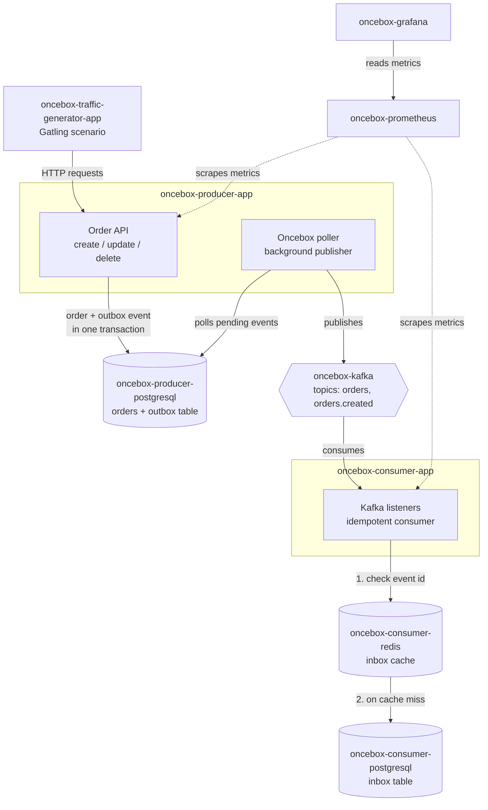

[](https://www.codefactor.io/repository/github/dmitriy-iliyov/oncebox)


## Overview

A demo project that showcases the [oncebox](https://github.com/dmitriy-iliyov/oncebox) library usage in a microservices architecture.

The `oncebox-example` project is a runnable demo with a **producer** that exposes single and batch REST endpoints 
(`POST`, `PATCH`, `DELETE` on `/api/orders` and `/api/orders/batch`) and a **consumer** with single and batch listeners for both Kafka and RabbitMQ.

The project demonstrates:
- atomicity between business operations and event publishing
- idempotent message consumption
- single-message and batch processing
- basic observability with Prometheus and Grafana

## Architecture Overview

The diagram shows every service started by the `kafka,postgres,test` profile combination. With the `rabbit` profile, RabbitMQ replaces Kafka; with `mysql` or `oracle`, those databases replace PostgreSQL.



Components:
- **oncebox-traffic-generator-app**: a Gatling scenario that sends order requests to the producer to generate load.
- **oncebox-producer-app**: serves the order API (create, update, delete) and saves each order together with its outbox event in one transaction. Its oncebox poller publishes pending events to the broker.
- **oncebox-producer-postgresql**: the producer's own database, holding the orders and the outbox table.
- **oncebox-kafka**: the message broker, carrying the `orders` and `orders.created` topics (RabbitMQ queues with the `rabbit` profile).
- **oncebox-consumer-app**: listens to both topics, handles single and batch messages, and skips events it has already processed. Its handlers only log the events.
- **oncebox-consumer-redis**: caches the ids of consumed events, checked before the database.
- **oncebox-consumer-postgresql**: the consumer's own database, holding the inbox table of processed event ids.
- **oncebox-prometheus**: scrapes metrics from the producer and consumer apps.
- **oncebox-grafana**: shows dashboards built from the Prometheus data.

## Ports 

| Service           | Port |
|-------------------|------|
| Producer API      | 8080 |
| Consumer API      | 8081 |
| Traffic Generator | 8082 |
| Apache Kafka      | 9092 |
| RabbitMQ          | 5672 |
| Prometheus        | 9090 |
| Grafana           | 3000 |


## Typical Flow

The happy path:

1. Traffic Generator sends HTTP requests to the Producer.
2. Producer:
   - persists business data
   - writes domain events to the outbox table, in the same transaction
3. A background publisher sends the events to Kafka/Rabbit.
4. Consumer processes the events idempotently.

### When something goes wrong

Each path below is a short description of what the example does. The oncebox docs explain the details and the settings.

- **A send fails.** The broker rejects the event or does not confirm it in time, so the publisher counts a failed attempt and puts the event back to `PENDING` with a later `next_retry_at`. The producer allows `max-retries: 3` attempts and waits longer after each failure (backoff `delay: 1m`, `multiplier: 1.5`). See [Retries and backoff](https://dmitriy-iliyov.github.io/oncebox-docs/docs/reference/processing/#retries-and-backoff).
- **Retries are exhausted.** The event becomes `FAILED` and, because the producer sets `oncebox.outbox.dlq.enabled: true`, a background job moves it to the dead letter queue (the `outbox_dlq_events` table), where it waits to be retried or given up on. See [Dead Letter Queue](https://dmitriy-iliyov.github.io/oncebox-docs/docs/reference/dlq/).
- **An instance dies mid-send.** An event that a dead or hung publisher captured stays `IN_PROCESS`. The stuck-event recovery job returns it to `PENDING`, without counting an attempt, and it is sent again. See [Stuck event recovery](https://dmitriy-iliyov.github.io/oncebox-docs/docs/reference/processing/#stuck-event-recovery).
- **The broker delivers a message twice.** Publishing is at-least-once, so a duplicate can reach the consumer. Every copy carries the same event id, and the consumer's inbox skips an id it has already recorded: it checks the Redis cache first and the inbox table on a cache miss. See [Inbox](https://dmitriy-iliyov.github.io/oncebox-docs/docs/reference/inbox/) and [Duplicates](https://dmitriy-iliyov.github.io/oncebox-docs/docs/reference/guarantees/#duplicates).
- **Batches.** The batch endpoints (`/api/orders/batch`) change several orders and store their outbox events in the same transaction. `create-order` events go to `orders.created` (a Kafka topic, or a RabbitMQ queue with the `rabbit` profile), where the consumer's batch listener receives them as a list; `update-order` and `delete-order` events go to `orders` and are handled one message at a time. See [Publishing Events](https://dmitriy-iliyov.github.io/oncebox-docs/docs/reference/publishing/) and [Inbox](https://dmitriy-iliyov.github.io/oncebox-docs/docs/reference/inbox/).

## Run
From the `oncebox-example` directory (the build context is the repository root, so the library
itself is built from source):

1. Build
```bash
docker compose build
```
2. Run
- with Apache Kafka:
```bash
COMPOSE_PROFILES=kafka,postgres,test docker compose up
```

- with RabbitMQ:
```bash
COMPOSE_PROFILES=rabbit,postgres,test docker compose up
```

> [!NOTE]
> For test with other database use `mysql` or `oracle`. The profile `test` using for enable traffic generator and observability container.  

## Dashboards

Grafana comes provisioned: the Prometheus datasource is pinned to the `oncebox-prometheus` uid and
the dashboards in [`docs/grafana`](../docs/grafana) are loaded from disk on start. Open
<http://localhost:3000> (`admin` / `admin`) and they are already there — nothing to import by hand.

The dashboards pick their datasource through a `datasource` variable instead of a hardcoded uid, so
the same files can also be imported into any other Grafana; pick the Prometheus instance from the
dropdown at the top of the dashboard.